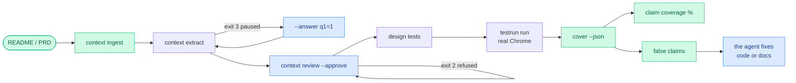

# claimcov

<p align="center">
  <b>Prove your documentation claims in a real browser</b><br/>
  Coverage for what you promised, not just for what you tested
</p>

<p align="center">
  <a href="LICENSE"></a>
  
  
  
</p>

---

## The idea

A README says the product exports to CSV, supports SSO, works offline. Those are
promises a reader trusts and no test guards. `claimcov` proves them in a real
browser and reports the percentage that survive.

**Coverage answers "does the code I wrote work". Claim coverage answers "are the
promises I published true".**

```text
README claims  ──▶  extract use-cases  ──▶  design tests
                                                │
                                                ▼
                                    real Chrome, real flows
                                                │
                                                ▼
                               proven vs owed, per claim
                                                │
                              ┌─────────────────┴─────────────────┐
                              ▼                                   ▼
                     coverage percentage              false claims listed
                                                              │
                                                              ▼
                                                  the agent fixes code or docs
```

## How it works

`claimcov` is a thin orchestrator over Kane CLI, which already does the hard
parts. It adds the layer Kane does not have: map the result to documentation,
compute the percentage, and emit a report an agent can act on.



## The closed loop

Kane signals outcomes through its exit code, which is what makes automation
possible. `claimcov` never parses free text to decide what happened.

| Exit | Meaning | What `claimcov` does |
|---|---|---|
| `0` | complete | continue |
| `2` | refused, e.g. `UC_UNREVIEWED` | read the `next` command, approve, retry |
| `3` | session paused | answer from `recommended_index`, resume |

A pause carries everything needed to continue:

```json
{
  "type": "session_paused",
  "sid": "ext-20261123T114116-3d721eb6-readme",
  "resume": "kane-cli context extract --resume ext-... --mode agent",
  "pending_questions": [
    { "id": "q1", "header": "offline scope",
      "options": [{ "label": "Leave unspecified" }],
      "recommended_index": 0 }
  ]
}
```

`recommended_index` is **0-based**; `--answer q1=M` takes a **1-based** option
number. Getting that off by one silently answers the wrong option, so it is
pinned by a test.

### Remember the inputs

`verify` needs the document, the product URL and the tag values every time.
`init` writes them once into `<dir>/claimcov.json` so later runs need no flags:

```text
$ node cli.mjs init docs/demo/README.md https://.../demo/ \
  --tag-values work,home
initialized .claimcov: docs/demo/README.md vs https://.../demo/
$ node cli.mjs verify
```

Explicit flags always win over the stored file.

## Verified against the real CLI and a real browser

Run on a headless Sandbox host, against a live demo app, not simulated.

**The loop:**

```text
$ node scripts/verify-loop.mjs doc.md work
ingest: 1 source
extract: paused
paused — q1: offline scope -> General only
answering (1) and resuming
resume -> complete
complete: 6 use-cases derived, 1 question(s) answered automatically
```

**The coverage (live run, 25 Nov 2026, Kane CLI 0.10.8):**

```text
$ node cli.mjs init docs/demo/README.md https://.../demo/ \
  --tag-values work,home
$ node cli.mjs verify --dir ~/.claimcov-live
found 5 claim(s): uc-1..uc-5
design uc-1..uc-5: complete (after context review --approve)
variables: filled
testrun: failed
cover: complete
gaps: complete

0/5 claims proven · 2 false · 3 unproven (58%)
  false    Sign in with Google (readme:16)
  false    Export all tasks to CSV (readme:15)
  owed     Create a tagged task (readme:12)
  owed     Mark a task complete (readme:13)
  owed     Filter tasks by tag (readme:14)
  16 gap(s) pending — ready commands are in the report
```

`verify` ran with no document or URL flags: everything came from `init`.
`testrun: failed` is Kane's exit on the failing acceptance criteria; the
coverage it left behind is complete and authoritative.

**Reconciling the verdict.** The three `owed` claims above are not unproven:
`cover` reported their state as `proven`, but the report only recognised
`covered` and printed them as owed. The mapper now accepts both, which
recomputes this exact run to **3/5 proven · 2 false** — the ground truth (the
app creates, completes and filters tasks; sign-in and CSV export do not
exist). The `(readme:16)` citations come from Kane's store, joined by
`src/sources.mjs`.

### Three things this cost

All three were found by running it against a live page, and all three are now
covered by tests:

**Kane declares variables it does not fill.** `design tests` writes
`{{start_url}}` into every test body and leaves the value empty. A test with an
empty input fails, and Kane reports it as an ordinary failure — so the whole
document looks like a lie when the real problem is a missing input.
`src/variables.mjs` fills what can be inferred and refuses to invent a secret.

**`testrun` takes `--agent`, not `--mode agent`.** The unknown option is a hard
refusal with exit 2, so the tests never ran and `cover` had nothing to report.

**`cover` says `proven`, the report only knew `covered`.** Both strings appear
in real `cover --json` output across runs. `STATE_TO_STATUS` maps both to
proven; anything else unknown stays owed, never proven.

Tag values are never invented: without `--tag-values work,home` (or repeatable
`--var name=value`) the tag variables stay empty and are reported as owed.

Cost of the full cycle: 331 credits (10,195 → 9,865).

## Install

Requires Node 20+ and Kane CLI:

```bash
npm install -g @testmuai/kane-cli
kane-cli login
```

No shared project is needed: Kane keeps a local store in `.context/`.

## Tests

```bash
npm test
```

75 tests, none of which need Kane, a browser or credits. The spawn path is
exercised through a stub binary that reproduces the real NDJSON stream and exit
codes.

## Status

| | |
|---|---|
| M1 closed loop (exit 0/2/3) | done |
| M2 claim coverage | next |
| M3 demo project with false claims | pending |
| M4 presentation | pending |
| M5 submission | pending |

## Limits

- **It cannot prove a claim about an app that does not exist.** Kane reports
  `missing start URL` until the product is reachable.
- Claims that need credentials or fixtures the operator has not supplied are
  reported as owed, never as proven.
- Browser only in v1; no iOS simulator or Android emulator.

## License

MIT. See [LICENSE](LICENSE).

Kane CLI is a product of TestMu AI and is licensed separately.
